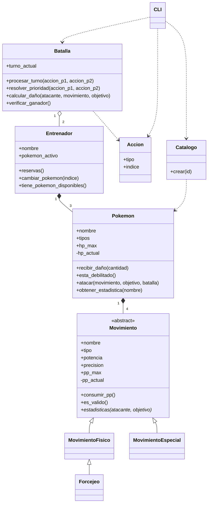

# Diagrama de clases

La interfaz CLI gestiona `elegir_accion` e `iniciar_combate`, separando las entradas de usuario del motor. El motor solicita los reemplazos mediante una función inyectada. El flujo es: comandos → validación → prioridad → ejecución → debilitamientos/reemplazos → victoria o siguiente turno.
